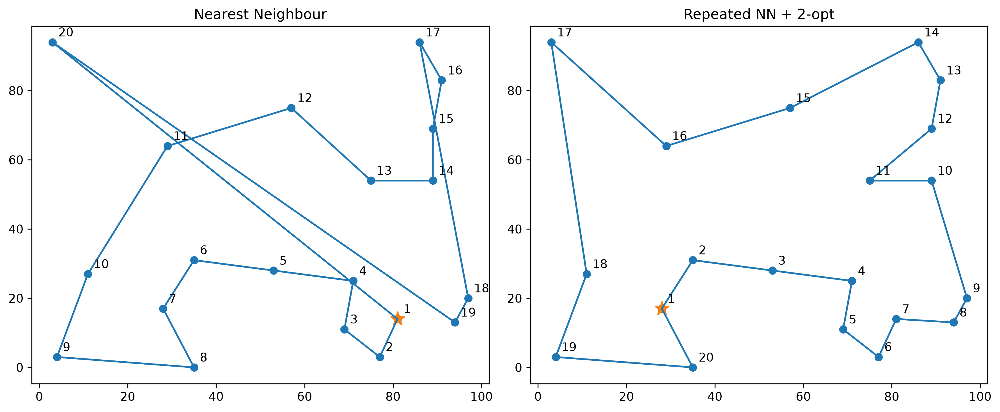

# TSP Visualiser

A Python visualiser for comparing travelling salesperson heuristics and route optimisation algorithms.

The project compares the solution quality and runtime of heuristic approaches against an exact brute-force solution for small TSP instances.

## Algorithms

- Nearest Neighbour
- Repeated Nearest Neighbour
- 2-Opt
- Brute Force

## Example Visualisation

The same randomly generated TSP instance solved using different heurist approaches:


can be run by

```
python example_visualisation.py
```

# Experimental Results

The algorithms were compared using randomly generated TSP instaces with a fixed random seed for reproducibility.

For problems containing 7 - 9 cities, the brute-force algorithm was used as a exact baseline. Nearest neighbour produces routes approximately 7 - 9 % above optimal, while repeated nearest neighbour reduced this to approximately 1%. Applying 2-opt produce routes within 0.03% of optimal in the experiments.

Brute-force runtime increased from approximately 0.0066 seconds at 7 cities to 0.595 seconds at 9 cities. This is a 91x increase. While the heuristic algorithms remained below 0.001 seconds.

The heuristics were also tested separetly with up to 100 cities. At 100 cities, nearest neighbour averaged approximately 0.0007 seconds, repeated nearest neighbour averaged 0.0074 seconds, and repeated nearest neighbour with 2-opt averaged 0.364 seconds.

These results demonstrate trade off between the guaranteed optimal and practical scalibility.

# Installation

## Requirements

- Python 3.9
- pip

## Setup

Clone this repository:

```
git clone https://github.com/maximilian-watson/tsp-visualiser.git
cd tsp-visualiser
```

Install the required Python packages:

```
pip install -r requirements.txt
```

## Running the program

Run:

```
python main.py
```

## Running the tests

Run:

```
python -m pytest
```
